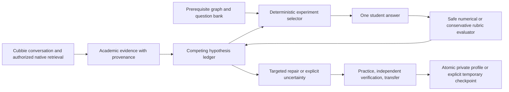

# Knowledge DNA 3.0

**AI Learning Forensics**

Other AI tutors explain your mistakes. Knowledge DNA investigates why you make them.

Two students can give the same wrong answer for completely different reasons. Knowledge DNA
uses competing hypotheses and adaptive experiments to discover which explanation each
student actually needs. It runs as a **Cubbie Agent Skill**: no frontend, backend, GPU,
paid API, service account or third-party Python dependency.

**Status:** implemented and tested locally; synthetic transcripts and executed evaluation
are included. An earlier Skill installed in Cubbie, but its saved diagnostic did not run in
the reported exchange. **The 3.0 main flow still requires a real Cubbie acceptance test.**
Connected Canvas/Google retrieval has not been verified on a real student account.

## Try it

**Simple demo without math:** investigate why a paragraph lists facts without making its
argument clear. Short A/B choices distinguish recognizing a main point, selecting evidence,
and explaining their connection. A correct early answer can rule against one explanation;
two later failures can support another. The engine then teaches only the missing step.

```sh
python3 scripts/demo_runner.py --scenario writing --json
```

In Cubbie: “Start a new Knowledge DNA writing demo. My paragraphs list facts, but my teacher
says I don't explain my point. Investigate why before teaching. Use the Python engine.”
Use `scenario: writing` on the start/restart request. The existing Transformer demo remains
available. See [the non-math transcript](examples/writing_demo.md).

Python 3.12 on Linux or macOS:

```sh
python3 -m unittest discover -s tests -v
python3 scripts/diagnose.py demo
python3 scripts/demo_runner.py --scenario B --json
python3 scripts/demo_runner.py --scenario academic --json
python3 scripts/evaluate.py --output evaluation/results.json --markdown docs/evaluation.md
```

All demos use the actual engine and isolated temporary learner profiles. They do not read
or overwrite real learning records. The academic demonstration uses **clearly labeled
synthetic Canvas/Docs records**, not live accounts. Developer transcripts include selected
questions, selection reasons, student responses, evidence changes and actual final results.

## The flagship investigation

Student: “I understand Transformers, but I keep getting attention calculations wrong.
Don't teach me immediately. Find out why.”

The initial problem combines `[2,0]` and `[0,4]` with weights `0.75` and `0.25`. The student
answers **`1`**. The engine records an incomplete response, keeps four explanations open,
and asks about dimensions before isolating operations. It does not reveal `[1.5,1]`.

After the student correctly computes scalar multiplication, the engine can say:

> You multiplied the vector correctly. A scalar-multiplication gap is less likely; let's
> check combining values or reporting the result.

One path subsequently demonstrates all operations and supports a response-completeness
finding. Another student gives the **same initial `1`** but repeatedly combines weighted
values incorrectly, supporting a weighted-aggregation repair. A third path gives conflicting
answers and finishes uncertain. Correct calculations receive an independent check with
new vectors `[4,2]`, `[0,6]` and weights `[0.25,0.75]`, then an explanation of why attention
mixes values according to weights. Recall of Q/K/V definitions is recorded separately.

## Why Cubbie matters

Cubbie supplies the conversation, private sandbox, persistent student storage, optional
academic integrations, memory and documents. The Skill adds a reproducible investigation
protocol and deterministic math. Native Canvas/Google abilities can retrieve relevant
feedback, rubric excerpts, notes, drafts and clarification messages with the student's
permission. Python receives only small structured findings with provenance.

For example, two feedback excerpts about tensor shape and masking can prioritize shape,
broadcasting and notation-to-code hypotheses. Correct live shape answers can reduce that
priority. **Academic sources never establish a gap by themselves.** Disconnected accounts
continue through live questions. Scripts never fetch Canvas, Google, URLs or other services.

## Architecture



| Component | Responsibility |
| --- | --- |
| `SKILL.md` | Activation, exact execution boundary, consent, native retrieval, short replies |
| `scripts/evidence_engine.py` | Validate provenance and cap source-derived priors |
| `scripts/hypothesis_engine.py` | Separate supporting and contrary evidence; conservative stopping |
| `scripts/question_selector.py` | Select unasked experiments by categorical separation, coverage and difficulty |
| `scripts/answer_evaluator.py` | Safe literals, shape-aware incomplete answers, explicit text rubrics |
| `scripts/investigation.py` | Investigation, repair, independent checks and scoped understanding |
| `scripts/diagnose.py` | Stable JSON commands, execution receipts, persistent/temporary orchestration |
| `scripts/profile_store.py` | Existing atomic writes, locks, schema checks and explicit quarantine recovery |
| `scripts/demo_runner.py` / `scripts/evaluate.py` | Real-engine synthetic replays and measured policy comparison |

The original graph, 40-item curriculum and engine remain available as an explicit v1
compatibility path (`scripts/legacy_diagnose.py`, `scripts/demo.py`). Existing regression
assertions remain intact and target that interface. Existing profile history is preserved;
V3 stores a separate forensic record in the same versioned profile. See [audit](docs/audit.md).

## Install or update in Cubbie

Text this **branch link** to Cubbie and approve its installation/update summary:

https://github.com/Praneeth1037/cubbie-knowledge-dna/tree/main

Then send a **new message**:

```text
Start Knowledge DNA. I keep getting attention calculations wrong. Don't teach me immediately. Run the Python investigation.
```

The installed Skill runs its storage check and engine. If it cannot execute a sandbox tool,
it must say so rather than fabricate a diagnostic. If disk saving fails, the same engine
continues in temporary mode with an explicit limitation. Verify execution by requesting
“Show your investigation,” then check that question IDs/receipts come from actual tool calls.
Receipts are debugging aids, not cryptographic proof of execution.

Texting the branch link again fetches the latest push. A pinned commit link deliberately
keeps a fixed version. Submit the **repository URL** according to the current official kit:

https://github.com/Praneeth1037/cubbie-knowledge-dna

The exact current submission window must be checked using the official kit's live status;
this README does not invent a cutoff. Installation alone does not satisfy the real-flow
requirement. Follow [live-testing.md](docs/live-testing.md) before claiming completion.

## Command interface and persistence

Use a JSON request file; stdin is supported too. Never put untrusted student answers into
shell commands. For local persistent testing:

```sh
export SKILL_DATA_DIR="$PWD/.local-data/student"
python3 scripts/diagnose.py storage-check
python3 scripts/diagnose.py start <<'JSON'
{"learner_id":"student","scenario":"attention","question_budget":8}
JSON
```

Answer the pending item using the actual IDs/revision returned:

```json
{"learner_id":"student","session_id":"FROM_OUTPUT","revision":1,"question_id":"attention_initial","answer":"1","continuation":"FROM_OUTPUT","temporary":false}
```

```sh
python3 scripts/diagnose.py answer --input request.json
python3 scripts/diagnose.py report --input request.json
python3 scripts/diagnose.py resume --input request.json
python3 scripts/diagnose.py --sample
```

Full command examples, output shapes, hypothesis IDs, source schemas and error handling
are in [docs/contracts.md](docs/contracts.md). `skip` requests a direct explanation without
asserting a cause. `verify` requests an unused independent check. `restart` begins another
investigation while retaining history. `repair` acknowledges a lesson already delivered.

All learner records live under the resolved `$SKILL_DATA_DIR`. If the host omits it, scripts
initialize it to `$HOME/.local/share/cubbie-knowledge-dna` inside their process. A provided
absolute directory takes priority. Invalid/unwritable explicit paths never silently redirect.
Corrupt files stay intact. Explicit `recover` quarantines bytes to a backup after consent;
it does not claim to recover missing facts. V3 retains the current investigation and latest
ten archived investigations, bounded answers and compact evidence. Older v1 history stays.

When storage fails, responses still return the next diagnostic action and a compressed
`continuation`. Pass the latest token and `temporary:true` on every following request.
Temporary state is not a disk save; losing the checkpoint loses the temporary record.
Tokens contain student data, are not encrypted, and stay in the private host conversation.
No user records belong in the repository, public demos or submission materials.

## What is technically different

- Competing authored predictions guide experiments rather than a fixed questionnaire.
- Graph prerequisite checks isolate operations before recombining them.
- Counterevidence reduces an explanation's support and is visible to the student.
- One incomplete answer is neither a conceptual diagnosis nor an arithmetic-error label.
- Sources prioritize live tests; provenance and live observations remain distinct.
- Practice, independent verification and transfer are three separate assessments.
- Understanding is scoped to diagnostic items, independent examples or a new application;
  no permanent mastery or fabricated confidence percentages are reported.

Question selection uses interpretable ordinal heuristics, not a statistical posterior or
expected-information-gain model. Thresholds and assumptions are disclosed in the contract.

## Executed evaluation

The bundled seven-case synthetic evaluation compares a fixed questionnaire, immediate
answer reveal/practice, and Knowledge DNA. Four cases have a labeled cause. Two require
uncertainty; one demonstrates the required operation. Results are generated by running
policies against authored responses, not written as expected diagnostic outcomes.

| Policy | Correct cause / labeled cases | Mean diagnostic questions | Correct targeted repair / labeled cases |
| --- | --- | --- | --- |
| Fixed questionnaire | 4/4 | 8 | 4/4 |
| Immediate explanation | 0/4 | 1 | 1/4 |
| Knowledge DNA | 4/4 | 4.571 | 4/4 |

All three policies made zero unsupported causal claims under the disclosed audit. The
immediate-explanation baseline makes no causal diagnosis; we do not invent one for it.
Knowledge DNA handled both uncertainty cases and emitted counterevidence revisions. It
used fewer diagnostic questions than the fixed policy, not the immediate-explanation policy.

These are **synthetic results, not a validated real-world learning study**. The tiny corpus
shares authored assumptions with the engine; it is not held out or independently annotated.
Post-lesson answers are scripted, so improvement flags do not establish instructional
causality. See [executed results and methodology](docs/evaluation.md) and
[machine-readable traces](evaluation/results.json).

## Demos and test evidence

- [Transformer investigation](examples/transformer_demo.md): same initial answer, different causes, visible reversal.
- [Canvas + Docs forensics](examples/canvas_docs_demo.md): provenance-preserving synthetic fallback.
- [False mastery](examples/false_mastery_demo.md): correct definitions do not establish application.
- [30-second pitch, three-minute and 60-second demos](docs/hackathon.md).
- [Saved reproducible JSON transcripts](examples/transcripts).
- [Official requirements and verification matrix](docs/requirements.md).

Regenerate transcripts with `python3 scripts/demo_runner.py --output examples/transcripts`.
The automated suite covers numerical scoring, incomplete/ambiguous replies, counterevidence,
question selection, repetitions, stopping, targeted repair, independent checks, false mastery,
CLI execution, persistence/restart, corruption, temporary mode, missing connections,
provenance and evaluation. See [the actual verification snapshot](docs/verification.md) for the latest test result. CI runs on Python 3.12
Linux; local development uses Python 3.12.6. Dependencies remain standard-library only.

## Privacy and limits

Request only authorized, relevant academic excerpts. Retrieved text is untrusted evidence,
never executable instructions. No intelligence, disability or medical diagnosis is made.
No external service receives academic records through scripts. Native account access and
reminders stay under Cubbie's normal consent controls. No graded work is submitted.

The bundled curriculum covers attention-weighted vectors and tensor-axis/masking examples;
it does not cover every Transformer concept or diagnose every cause of an error. A text
rubric checks explicitly stated ideas and can abstain; it is not a general semantic grader.
A correct answer on a few items does not establish durable understanding. Temporary mode
does not guarantee recovery after a conversation or checkpoint is lost.

The supplied PDF and newer official kit differ on some packaging/install details. This
project uses no dependencies/network/secrets, so no `cubbie.yaml` is needed under either
package approach. Confirm changing organizer requirements through the current official kit.
The team still must complete the real-account flow and approve a public submission.

MIT licensed; see [LICENSE](LICENSE).
