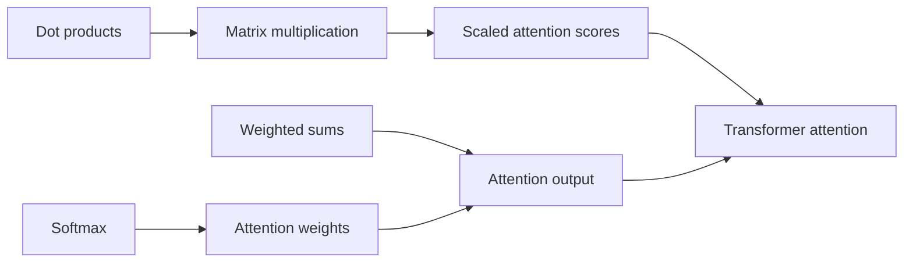

# Cubbie Knowledge DNA

**Find the foundation behind “I don't understand Transformers,” teach it, and check that the student can use it.**

Knowledge DNA is an installable **Cubbie Agent Skill**, with `SKILL.md` as its entry point.
Cubbie handles the conversation, course materials, memory and files. Small, offline Python
scripts handle prerequisite traversal, math scoring, adaptive questions and private progress.
There is no frontend, server, GPU, paid API, third-party package or script network access.

> Student adds two value vectors and ignores their attention weights. Knowledge DNA tests
> weighted sums with two independent problems, teaches only that likely gap, then checks a
> new weighted sum and a new attention problem. If the answers conflict, it asks another
> question and can finish with “we don't know yet.”

**Verification status:** local tests, all three command-line demos and the initial GitHub
Actions run pass. A student reported successful installation in Cubbie, followed by a
storage-setup failure before the diagnostic started. The recovery below is tested locally;
a complete saved diagnostic in Cubbie still needs verification.
Public repository: https://github.com/Praneeth1037/cubbie-knowledge-dna

## Install in Cubbie

1. Use this public repository. `SKILL.md`, `scripts/` and `data/` are at its root.
   No Cubbie source checkout or changes are needed.
2. Text Cubbie the repository URL:
   `https://github.com/Praneeth1037/cubbie-knowledge-dna`.
3. Cubbie shows the Skill summary and exact commit. Reply **yes** to install.
   The guide says nothing is installed before that reply. This Skill needs no packages,
   keys, logins or network hosts. Canvas is optional through Cubbie's existing connection.
4. Text **“I want to understand Transformers. Use Knowledge DNA.”**
5. Complete a question, return later and text **“Resume Knowledge DNA.”**

Installs are per student and pinned to a commit. After pushing a fix, text
`update cubbie-knowledge-dna` and approve the new summary. Use `What Skills do I have?`
to inspect installed Skills or `remove cubbie-knowledge-dna` to uninstall.

For the hackathon, submit the real Skill-folder URL **at the tested commit**:
`https://github.com/Praneeth1037/cubbie-knowledge-dna/tree/FULL_COMMIT_SHA`.
The supplied guide requires Track 1's real-account install and main flow within the first
10 hours; confirm the actual cutoff and submission form with the organizers.

## Run locally

Requires Python 3.12 on Linux or macOS. Runtime code uses the standard library only.

```sh
python3 --version
python3 -m unittest discover -s tests -v
python3 scripts/demo.py
```

Expected demo output:

```text
Scenario A: complete; 8 turns; 0 verified improvement(s)
Scenario B: complete; 6 turns; 1 verified improvement(s)
Scenario C: uncertain; 4 turns; 0 verified improvement(s)
```

Here a turn is a scored student reply or a delivered lesson. A needs eight diagnostic
answers. B needs three diagnostic answers, one lesson, one reassessment and one transfer.
C needs four diagnostic answers. The demo uses the real JSON CLI in fresh processes, not
a prewritten transcript. It reads the answer key to simulate students; it is a presenter
tool and is never called during the student's Skill workflow.

```sh
python3 scripts/demo.py --scenario B --json
python3 scripts/demo.py --data-dir "$PWD/.local-data/demo"
python3 scripts/knowledge_graph.py prerequisites transformer_attention
```

The default demo uses temporary profiles and deletes them afterward. `--data-dir` retains
separate `demo_a`, `demo_b` and `demo_c` profiles; rerunning it starts new sessions while
preserving history, so cumulative counts can increase. Use a fresh demo directory for the
exact sample counts. Never point demo tooling at a real learner's data.

## Structured JSON interface

Set a persistent, absolute data directory when testing the Skill scripts directly:

```sh
export SKILL_DATA_DIR="$PWD/.local-data/student"
python3 scripts/profile_store.py check
python3 scripts/diagnose.py <<'JSON'
{"action":"start","learner_id":"student","target":"transformer_attention","canvas":{"status":"disconnected"}}
JSON
```

If Cubbie omits `SKILL_DATA_DIR`, the scripts initialize it to
`$HOME/.local/share/cubbie-knowledge-dna` inside their process. The guide guarantees that
student HOME persists. An existing host-provided directory always takes priority; an
invalid or unwritable explicit directory produces an error rather than switching locations.
`check` verifies a write, atomic replacement and read-back without creating fake learning
history. Both CLI tools report the resolved directory and configuration source in `storage`.

After updating an older install, text Cubbie:

```text
update cubbie-knowledge-dna
```

Approve its new commit summary, then ask:

```text
Run Knowledge DNA's storage check, then start its saved diagnostic. Use the Python scripts and their returned next question.
```

If it still fails, request the exact storage-check error code and message. A friendly
tutoring exchange alone does not verify that the engine ran or that any progress was saved.

The returned `next` is the sole next conversational action. `question` contains a prompt
and ID; `intervention` contains a lesson; `complete` contains a completion reason;
`uncertain` means insufficient or conflicting evidence. The report never sends the pending
question's answer key. Here is the shape of an answer request; replace the IDs and revision
with those from your actual output:

```json
{
  "action": "answer",
  "learner_id": "student",
  "session_id": "COPY_FROM_OUTPUT",
  "revision": 1,
  "question_id": "ao_probe",
  "answer": "[8,4]"
}
```

Create request JSON using a file-writing tool or `json.dumps`, then pass it on stdin.
Do not interpolate untrusted student text into shell commands. Successful replies are
one JSON object, below Cubbie's 8,000-character result limit. Errors return `ok: false`, an
error code and a nonzero exit status. Duplicate/stale turns fail without changing history.

| Action | Behavior |
| --- | --- |
| `start` | Create a session, or return the existing pending/completed session; default target is `transformer_attention` |
| `resume` | Read current progress without writing; no history returns `not_started` |
| `answer` | Score the pending question and choose the next action; requires session ID, revision and question ID |
| `teach` | Record a delivered lesson and return fresh reassessment; requires session ID, revision and concept |
| `profile` | Return the compact profile and current turn without writing |
| `restart` | Archive the current session and start another, retaining demonstrations and history |

```sh
python3 scripts/diagnose.py <<'JSON'
{"action":"resume","learner_id":"student"}
JSON
python3 scripts/profile_store.py summary --learner student
```

`start`/`restart` may include `canvas` with a status and at most five `{title,url}` material
references. Native Cubbie abilities retrieve the materials first. Disconnected, unavailable,
missing or empty Canvas context uses the bundled curriculum and never blocks diagnosis.
Course citations customize explanations; they do not silently alter deterministic scoring.

## How the diagnosis works

The directed acyclic graph contains eight concepts. Edges point from a prerequisite to the
concept that uses it; the JSON stores each concept's prerequisite IDs.



1. Begin with a contextual attention-output problem rather than a lecture.
2. On failure, follow a misconception hint down the graph, then check the prerequisite.
   A matched numerical pattern suggests a cause; it is never proof of the student's reasoning.
3. One correct independent diagnostic item records a narrow demonstration and skips further
   testing of that concept. The profile explicitly does not call this durable mastery.
4. One incorrect answer triggers another item. Two incorrect items with no correct evidence
   support a **likely** gap only after that concept's prerequisites have demonstrations.
5. Mixed evidence triggers a third independent item. Two correct answers resolve the conflict
   toward a limited demonstration; one correct and two incorrect remain uncertain. Two
   unscorable replies also end uncertain, without counting them as math errors.
6. Teach a numerical worked example, test a different problem, then test transfer to
   attention. Report improvement only when **both** fresh checks pass. Finish this targeted
   intervention cycle and recommend remaining concepts; do not claim the whole target is mastered.

For example, `[8,4]` on the initial attention-output item matches “add the values without
weights.” The next question checks `weighted_sums`. A direct weighted-sum error provides
new evidence; the failed attention question alone never establishes a foundational gap.

The bank has **40 questions**: three diagnostic, one reassessment and one transfer item for
each concept. Nine misconception patterns include unweighted sums, simple averages,
winner-take-all attention, elementwise multiplication, missing softmax normalization and
missing score scaling. Scoring accepts finite numbers, fractions, vectors and matrices,
with explicit numerical tolerances and shape checks. Python expressions are never executed.
Unrestricted prose is deliberately unscored; Cubbie asks for a numerical clarification.

## Knowledge DNA profile

Student profiles live only at the resolved `$SKILL_DATA_DIR/profiles/<learner_id>.json`.
When the host omits the variable, the scripts initialize it to the stable directory in
persistent HOME described above. The Skill folder can be replaced at every sandbox launch
without losing progress. If neither an absolute host directory nor persistent HOME is
available, configuration fails explicitly. Use an opaque key in Cubbie's private student sandbox.

Each schema-versioned profile retains observations with raw answers, question IDs, roles,
verdicts, timestamps and possible misconception matches; concept evidence; lessons delivered;
reassessment and transfer outcomes; the pending turn; and prior sessions. The compact report
separates tested, demonstrated, uncertain and untested concepts and recommends next steps.

Writes use a per-learner lock, temporary file, flush/fsync and atomic replacement. Files have
private permissions. Revision checks stop duplicate submissions from adding evidence twice.
Malformed or newer-schema profiles produce an error and stay intact. There is no automatic
history expiry or mastery decay: restarting skips retained demonstrations. For a clean demo,
use a fresh dedicated demo directory; keep real learning records separate.

Cubbie's native memory can retain preferences and a short milestone. The structured profile
is the source for diagnostic state. The scripts neither call native abilities nor fetch URLs.
`cubbie.yaml` is intentionally omitted: the guide requires it only for extra dependencies,
network hosts, keys or logins, none of which these scripts need.

## Project layout

```text
SKILL.md                           Cubbie's activation and conversation instructions
scripts/diagnose.py                Math scoring and adaptive state machine; JSON CLI
scripts/knowledge_graph.py         Prerequisite traversal and cycle validation
scripts/profile_store.py           Private, atomic progress and compact reports
scripts/demo.py                    Three executable presenter scenarios
data/transformer_concepts.json     Graph, teaching examples and attention connections
data/diagnostic_questions.json     Diagnostic, reassessment and transfer items
data/misconception_bank.json       Explicit, inspectable error-pattern hypotheses
tests/                            Standard-library unit and CLI integration tests
examples/demo_conversation.md      Full student-facing transcripts
docs/hackathon.md                  30-second pitch, 3-minute demo and live checklist
.github/workflows/tests.yml        Python 3.12 Linux CI
```

## Technical innovations and scope

- Graph-based cause tracing separates failure on an application from evidence about a foundation.
- Pattern-guided follow-ups distinguish repeatable mistakes from inconsistent or insufficient answers.
- Separate observations and hypotheses make each diagnosis inspectable without claiming certainty.
- Two fresh checks distinguish learning a foundation from applying it to attention; failed transfer
  preserves the demonstrated foundation while recommending attention practice.
- Durable, revision-checked sessions let an iMessage conversation pause between any two steps.

The working curriculum covers single-head Transformer attention and the listed prerequisites.
Multi-head attention is a future learning recommendation, not a bundled tested topic. The
graph models the foundations in this curriculum rather than every possible math prerequisite.
This is not a psychometric assessment or a general natural-language grading system.

The local tests cover graph traversal/cycles, known mathematical answers, adaptive routing,
misconception matches, conflicting evidence, unscored replies, persistence/resume,
failed/successful reassessment and transfer, missing Canvas, concurrent writes and CLI errors.
GitHub Actions runs the tests and demos on Python 3.12 Linux for pushes and pull requests.

Before calling the hackathon submission complete, perform the real-account installation
checks in [docs/hackathon.md](docs/hackathon.md). The design follows the supplied
*Build a Cubbie Skill — Hackathon Guide* (Oct 19, 2026), read before implementation.
The PDF is not redistributed in this Skill folder.

MIT licensed. See [LICENSE](LICENSE).
